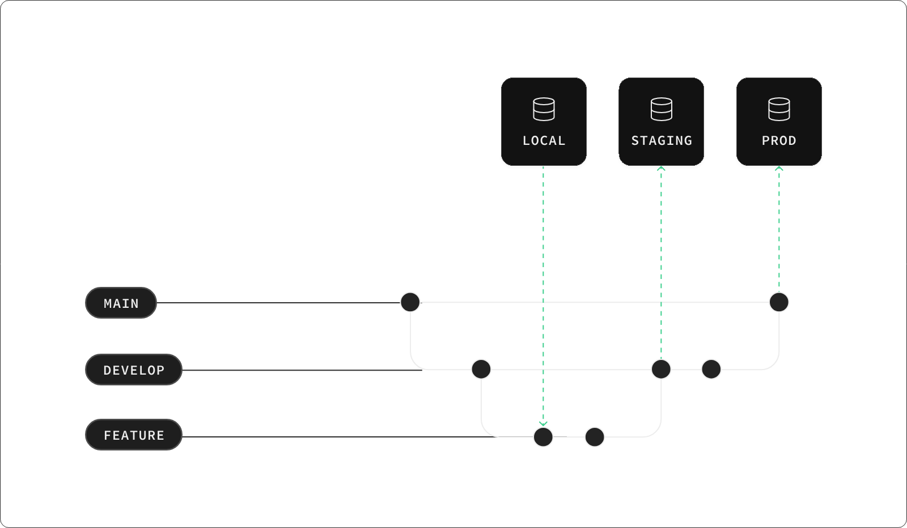

# Release (Supabase Github App)
We run our deployments following best practices from [Supabase Managing Environments](https://supabase.com/docs/guides/cli/managing-environments).


Then, we follow [database branching](https://supabase.com/docs/guides/platform/branching) to handle the deployments

## Deployment Commands

### Deploy Supabase functions

Each function declares its own dependencies in `supabase/functions/<name>/deno.json`, following the [Supabase dependency guide](https://supabase.com/docs/guides/functions/dependencies), so no import map flag is needed. Run this from the project root after `supabase link`:

```bash
supabase functions deploy
```

To deploy a single function, pass its name, for example `supabase functions deploy stripe_webhook`. Functions whose `config.toml` entry sets `verify_jwt = false` (the Stripe webhook and `get_stripe_url`) keep that setting on deploy.

### Set supabase secrets from .env file

```bash
supabase secrets set --env-file .env
```